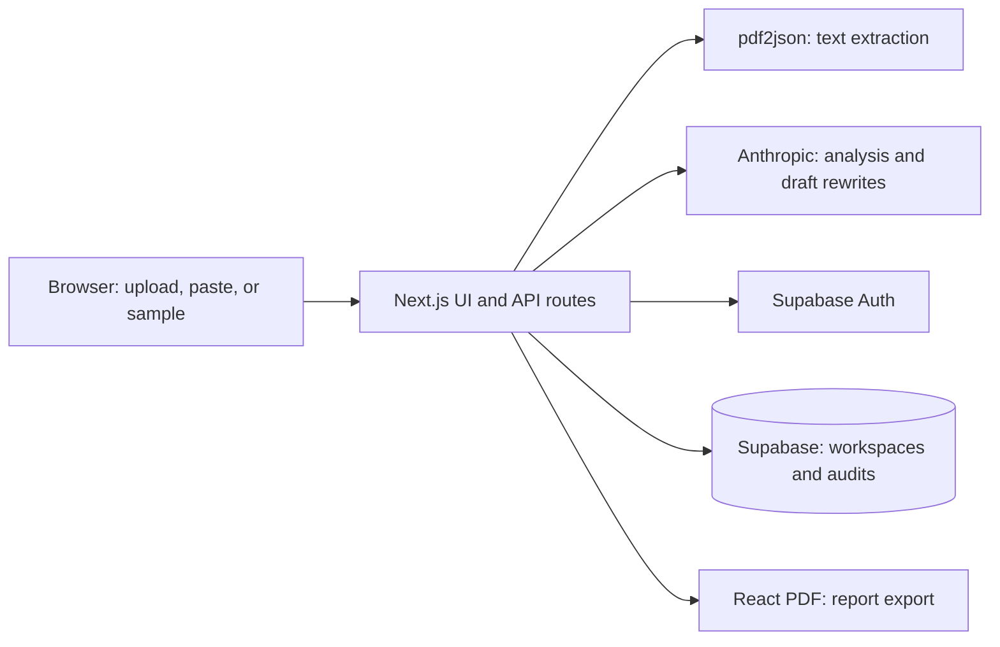

# EquiScan

An AI-assisted review tool for potential sex and gender bias in medical educational content. Upload a PDF, paste text, or choose a sample to inspect flagged passages, evidence references, and suggested rewrites. Generate a draft addendum and export a PDF report.

**Status: local prototype being prepared for v1.** Production build, TypeScript, and lint checks passed on October 1, 2026. Live authentication, database isolation, and the complete audit workflow still need verification. There is no verified public deployment yet.

See the [v1 roadmap](ROADMAP.md), [release checklist](docs/release-checklist.md), and [demo and engineering guide](docs/portfolio.md).

## Architecture



The application uses Next.js 16, React 19, TypeScript, and Tailwind CSS 4. Anthropic requests run on the server using `claude-sonnet-4-6`. This is a prompted foundation-model application; no custom model has been trained. The Anthropic and Supabase service-role keys remain server-side. Database access depends on correctly configured row-level security.

## Run locally

Requirements: Node.js 20.9 or newer, npm, an Anthropic API key, and a configured Supabase project. Initial checks used Node.js 24.15.0.

```powershell
npm ci
# Only copy if .env.local does not already exist:
Copy-Item .env.example .env.local
```

Fill in `.env.local`, then run `npm run dev` and open [localhost:3000](http://localhost:3000). Do not overwrite existing credentials.

| Variable | Purpose |
| --- | --- |
| `ANTHROPIC_API_KEY` | Server-side AI requests |
| `NEXT_PUBLIC_SUPABASE_URL` | Supabase project URL |
| `NEXT_PUBLIC_SUPABASE_ANON_KEY` | Public client key, subject to database policies |
| `SUPABASE_SERVICE_ROLE_KEY` | Existing development-only login helper; never expose to the browser |

Database migrations are not yet in the repository. An empty Supabase project is insufficient for saved audits; schema recovery is the first foundation milestone. AI actions incur provider charges, including analysis of the built-in sample inputs.

## Verify

```powershell
npm run lint
npx tsc --noEmit
npm run build
```

The build requires network access for Google Fonts and currently reports the middleware-to-proxy deprecation warning. These checks establish static/build health, not AI accuracy or database isolation. Automated behavioral tests and CI are planned.

## API

| Method | Path | Purpose |
| --- | --- | --- |
| POST | `/api/extract-pdf` | Extract text from a PDF, currently limited to 10 MB |
| POST | `/api/scan` | Analyze text across five bias categories |
| POST | `/api/rewrite` | Generate three rewrite drafts |
| POST | `/api/addendum` | Draft a sex and gender considerations section |
| POST | `/api/export-pdf` | Export analysis and optional addendum |
| POST | `/api/save-scan` | Save document, scan, and flags for a signed-in user |
| POST | `/api/update-flag` | Update a saved flag's review status |

The existing `/api/dev-login` helper rejects production requests. Paid AI endpoints currently lack authentication and usage limits; unrestricted public deployment is not ready.

## Analysis scope and limitations

The taxonomy covers male-default cases, missing female symptom presentations, generic male pronouns, psychosomatic attribution, and missing sex-disaggregated data. Findings require educator/editor review. Grades are model-generated heuristics, not validated measures of clinical quality. Rewrites and addenda require domain review.

Citations are constrained by a prompt library but are not yet validated in code. Scans silently truncate at 60,000 characters and addenda at 40,000. PDF extraction can merge words; exact-match highlighting can miss passages. These are tracked release blockers.

Source text is sent to Anthropic. Signed-in scans attempt to store source text and results in Supabase. Use non-sensitive educational examples during prototype testing. The existing in-app privacy copy needs correction.

## Current scope and next milestones

Scanner, rewrite controls, addendum, PDF export, login UI, save endpoints, and dashboard queries exist. Persisted flag IDs are not connected to review controls, grading differs between dashboard and scanner, and saved audits cannot yet be reopened.

V1 completes this workflow before deployment. Later work adds a reviewed benchmark and evidence retrieval. Custom model training depends on a measured comparison; see the [roadmap](ROADMAP.md).

## Development workflow

Use focused commits, relevant checks, and documentation updated alongside behavior. Comment on constraints and non-obvious decisions rather than narrating code. See [contributing](CONTRIBUTING.md).

## Project background

EquiScan began as a hackathon project by Safwan and Mayur, inspired by a medical domain expert in Safwan's family. Early briefs trace its evolution from patient advocacy to educational content review. Their statistics and market claims remain research leads to verify.
